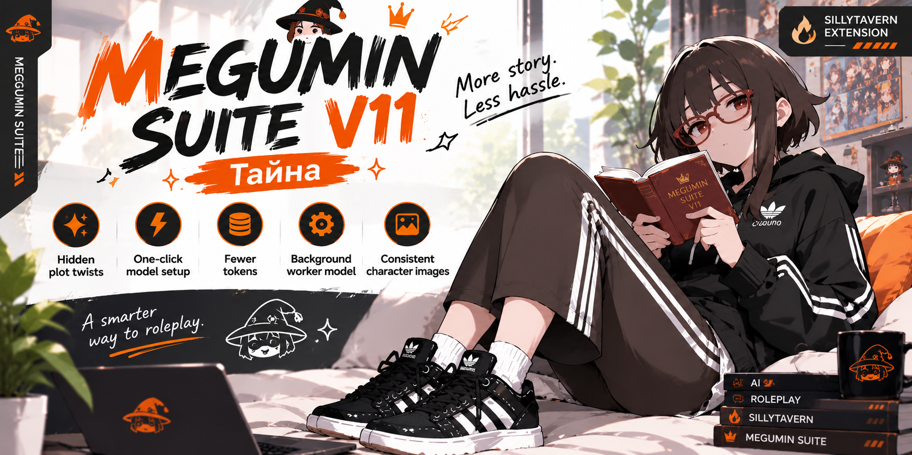

<div align="center">



<h3>A SillyTavern preset and extension rolled into one: the writing engine, memory, state trackers, and ComfyUI image generation for long-form roleplay.</h3>

[](https://github.com/SillyTavern/SillyTavern)
[](#)
[](https://creativecommons.org/licenses/by-nc/4.0/)
[](https://discord.gg/ansfSn9ed)

[What is it](#what-is-megumin-suite) · [Install](#install) · [Model Setup](#model-setup) · [V11 Тайна](#v11-тайна) · [The Notebook](#the-notebook) · [World State & Blocks](#world-state-and-blocks) · [Chomusuke](#chomusuke) · [Images](#images) · [Support](#support-the-project) · [Discord](https://discord.gg/ansfSn9ed)

<br>

> 💜 **Huge thanks to [NanoGPT](https://nano-gpt.com/r/rcwJx7hF)** for providing the API key used to test and tune V11 across all these models! If you want easy, pay-as-you-go or subscription access to every major RP model in one place, check them out using my referral link: **[nano-gpt.com/r/rcwJx7hF](https://nano-gpt.com/r/rcwJx7hF)**

</div>

---

## What is Megumin Suite?

Megumin Suite is a SillyTavern extension/preset that changes how presets work. A standard preset sends the exact same wall of instructions on every single turn. Megumin builds the prompt dynamically for each message, only injecting instructions when that specific turn actually needs them—like a real dice roll handled by the extension, or image generation tags when a picture is due. Because the prompt stays lean, the model keeps its attention where it belongs: on the story.

It also handles all the bookkeeping for you in the background. It tracks where everyone is, what they're wearing, how each character feels about you, what's in your inventory, and even the hidden plot twists the story is building toward. The extension feeds the clean, up-to-date values back to the AI every turn so long roleplays don't lose the plot after fifty messages. On top of that, you get an NPC Bank, long-term chat memory, a dynamic slop/phrase ban list, and local image generation through ComfyUI.

Everything is modular and has its own toggle. You can run just the core writing engine, go all-in with trackers and images, or mix and match whatever fits your style.

---

## What's new in V11

V11 **Тайна**. The headline feature is that your stories can now actually keep secrets: the AI decides on hidden truths early on, plants subtle clues over time, and holds off on the big reveal until the narrative earns it.

- **One single preset file.** You only need to import `Megumin Suite V11 Universal.json`. The old separate Engine and Image presets are gone.
- **One-click Model Setup (optional).** Pick the model you're using and the suite automatically applies the exact configuration I tested for it.
- **Delta updates (the model only writes what changed).** The extension remembers the full World State, bonds, and character sheet on its own, feeding the true state back to the model each turn. The AI only outputs small changes, and since it never has to read 1000 old tracker blocks in the chat (it only sees the current state the extension shows it), you save a ton of both output and input tokens on every reply.
- **Chomusuke (Secondary Worker Model).** Offload background chores and tracking blocks to a fast, cheap secondary model so your main model can focus 100% on writing prose.
- **Images V2.** Built-in character consistency so characters actually look like themselves from one image to the next.

---

## Install

1. In SillyTavern, open **Extensions** (the stacked blocks icon) and click **Install Extension**.
2. Paste this repository URL and install:
   ```text
   https://github.com/Arif-salah/Megumin-Suite
   ```
3. Download `Megumin Suite V11 Universal.json` from the [Presets folder](https://github.com/Arif-salah/Megumin-Suite/tree/main/Presets).
4. Open **AI Response Configuration** (the sliders icon), click **Import Preset**, and select the file you just downloaded.
5. Select **Megumin Suite V11 Universal** from the preset dropdown.
6. Refresh SillyTavern.

> [!IMPORTANT]
> The preset comes bundled with its own regex scripts (for the thinking box, block cleanup, and image tags). After importing, open **Extensions → Regex** and make sure all the Megumin scripts are enabled.

> [!NOTE]
> **Mobile users:** Phone browsers love to rename downloaded JSON files to `.json.txt`. Make sure to rename it back to `.json` in your file manager before importing.

> [!TIP]
> **Upgrading from V10?** You can delete the old Engine and Image presets. Just import the V11 Universal preset—your ongoing chats will carry over automatically. The first time you open an old chat, V11 will read in its last World State and blocks seamlessly.

---

## Quick Start

<div align="center">
  
  
  
  
</div>

1. **Open the suite** using the magic wand icon in the top bar. You'll land right on the **Model Setup** tab.
2. **Pick your model** and hit **Use this loadout** *(optional)*. This automatically configures the preset variant, thinking style, response length, ban list, and Chomusuke settings. A loadout is just the config I tested for that model. You can skip it and customize everything yourself, or use any engine you want.
3. **Choose your trackers** in the **Blocks** tab. Starting with two or three is usually the sweet spot.
4. **Start chatting.** The suite handles the prompt assembly and state tracking quietly in the background.

> [!TIP]
> Only turn on the blocks your story actually uses. Every active tracker takes up a slice of the model's attention—once you stack more than three or four at once, the actual prose can start to feel thinner.

---

## Model Setup

> *"Tested settings for your specific model, applied in one click."*

About half the bug reports I get come down to mismatched settings—things like prefill toggles, CoT formatting, or how trackers are prompted. Model Setup takes the guesswork out of it. It's completely optional: a loadout is just the config I tested for that model, and you can always skip it and pick your own engine and settings.

- **Tailored loadouts per model family.** Selecting a loadout sets the right engine variant, thinking prompt, target length, ban list size, Immersive HTML, and Chomusuke routing based on my testing.
- **Four loadouts ready out of the box:**
  - **Gemini Pro** (Gemini 3.1 Pro, 2.5 Pro, Gemini 4)
  - **Claude** (Opus 5.5)
  - **Big Open Models** (GLM 5.3, GLM 5.3 Flash)
  - **Fast Models** (DeepSeek)
  - *(Loadouts for Gemini Flash, Overthinkers like Kimi K3 / Xiaomi MiMo V2.6, and Local models like Gemma 4 31B / Qwen 3.8 27B are coming soon!)*
- **Quirk warnings included.** Each loadout tells you what to watch out for—for example, reminding you that Claude and GLM work best with prefill turned off, or that DeepSeek needs Chomusuke enabled because it loves skipping tracker blocks.
- **Nothing is locked in.** You can preview and tweak every setting before applying a loadout, or adjust things freely afterward.
- **Global or per-character.** Loadouts apply across your whole setup by default, or you can check **Only this character** to keep a specialized setup tied to one card.

---

## V11 Тайна

> *"My sharpest, most natural writing engine yet."*

- **Built for natural dialogue.** Characters talk like real people—short, grounded lines with subtext and action woven around them, rather than stiff, overly dramatic paragraphs.
- **Distinct character voices.** The engine actively tracks what each character wants and what they're hiding, stopping the AI from blending everyone into the same personality.
- **Strict user agency.** The model won't speak, think, feel, or take actions for your character, and it respects the actions you attempt.
- **Three engine variants:**
  - **V11 Тайна:** The standard single-narrator engine.
  - **V11 Тайна · Writers' Room:** Uses a five-person writers' room persona inside the thinking block to brainstorm before writing.
  - **V11 Тайна DeepSeek:** Adds a line made for DeepSeek, which tends to speak for your character and treat {{char}} as the player. It makes clear that you play {{user}}, and that {{char}} and everyone else in the story are the AI's to write and move.
- **Two narrative styles:** **V11 Default** gives you an expressive narrator with personality and teeth; **V11 Inside** keeps the narration tightly anchored inside one character's POV at a time. You can swap between engine variants without losing your chosen style.
- **Built-in Chain of Thought:** Each V11 engine comes with its own CoT that walks the model through the scene step-by-step, plus a **Thinking Cap** version that reins in reasoning models that tend to ramble for thousands of tokens (DeepSeek, Kimi, GLM, Qwen).
- **Prompt-cache friendly.** Core instructions stay locked at the top of the prompt without shifting around, so APIs with prompt caching charge you significantly less per turn.
- **Full or Short ban lists.** Choose between the comprehensive slop ban list or a condensed version specifically tuned for Chinese models, which can bog down when given huge negative constraints.

> [!NOTE]
> Prefer one of the older engines? V10, V9, V8, V7, and legacy presets are all still available under **Preset & Thinking → All**.

---

## The Notebook

> *"Slow-burn mysteries and secrets that actually pay off."*

Normally, when an LLM invents a cool secret or plot twist in its thinking block, it forgets all about it two turns later—or blurts it out immediately. The Notebook fixes that.

- **Persistent hidden truths.** Early in the roleplay, the engine establishes two or three hidden truths about the situation or NPCs, drops breadcrumbs over time, and waits to reveal them until it makes sense in the story.
- **Stored by the extension, not just the chat history.** The extension injects the active truths each turn so the model can't accidentally hallucinate away a plot point or retcon its own mystery.
- **Automatic clue verification.** If the model claims in its reasoning that it planted a clue, the extension checks the actual reply—if the clue didn't make it into the prose, it gets flagged as **not found in the reply**.
- **Full manual control.** Open The Notebook tab anytime to edit truths, mark them as revealed, delete them, or check the **Past** log to see completed arcs and the exact messages where clues were dropped.
- **World-only secrets.** The Notebook only generates truths about the world and NPCs—it never overwrites your own character's backstory or motives.
- **Enabled automatically with V11**, and can be toggled on for any older engine in The Notebook tab.

---

## World State and Blocks

> *"The AI reads clean, live state data—not a hundred outdated tracker blocks."*

All your trackers live in a clean, tabbed card right underneath each reply: World State, CYOA choices, NPC Inner Chatter, Bonds, Character Sheet, Story Tracker, New NPCs, and Dice.

- **Delta updates save tokens.** Instead of regenerating a massive stat block every turn, the model only writes brief change lines like `Aqua · Outfit: blue dress → bath towel`. You save on input tokens too: the AI doesn't see 1000 old tracker blocks piled up in the chat, only the current state the extension shows it. Way fewer tokens both ways, and the AI never accidentally deletes half your inventory.
- **One clean Current Info injection.** Each turn, the extension compiles the true, current numbers for bonds, stats, and the scene into a single block. The model isn't forced to read through fifty old turns of conflicting affection numbers in the chat history.
- **Old blocks are stripped from AI context.** You can still see every historical tracker card in the UI, but old blocks are hidden from the prompt by default so they don't eat up your context window.
- **Swipe-safe state rollback.** Swiping, editing, or deleting a message cleanly reverts whatever changes that reply made. Your state never gets desynced when you reroll.
- **Object permanence for NPCs.** If a character leaves the room and walks back in ninety messages later, the suite still remembers what they were wearing and what they were doing.
- **Capped lists to prevent bloat.** Plot threads, seeds, and timers are capped (max 3 threads, 3 seeds, 2 timers; Seeds only appear when The Notebook is off, since its clues take their place) so the World State stays focused instead of ballooning forever.
- **Built-in GUI editors.** Jump into the World State or Bonds editors anytime to tweak a number, add an NPC, or wipe a character from memory.
- **Saved per chat and branch.** Every chat file—and every checkpoint branch—maintains its own independent state.
- **Clickable CYOA buttons.** Click a generated choice to drop it straight into your input box (or Shift-click to send it immediately).
- **True RNG dice rolls.** The extension rolls the dice *before* the model writes its response, so the AI actually has to respect the roll instead of fudging the numbers to fit what it wants to write.
- **Custom stats.** Add whatever custom fields you want—Mana, Sanity, Jealousy, Reputation—straight into Bonds or the Character Sheet.

---

## Chomusuke

> *"A dedicated background worker so your main model stays focused on the prose."*

- **Save money and speed up turns.** Let a fast, dirt-cheap model handle the administrative chores while your heavy-hitting flagship model focuses entirely on writing the story.
- **Granular job routing.** Toggle Chomusuke individually for World State, Blocks, The Notebook, Image Prompts, Memory Summarization, NPC Bank, Story Director, Banned Phrases, and the Writing Style generator.
- **Offload tracker generation.** Have Chomusuke write your World State, Bonds, Character Sheet, Inner Chatter, or CYOA blocks behind the scenes so your main model only outputs story text.
- **Batched API calls.** Flip on **Combine calls** to bundle all background jobs for a turn into a single request (with an automatic fallback to separate calls if the model drops a section).
- **Zero profile switching lag.** Chomusuke talks directly to its assigned Connection Profile in the background—SillyTavern never has to switch your active connection or reload the chat.
- **Live status indicator.** A pulsing Chomusuke icon with a **Stop** button sits on the block bar whenever background tasks are running.

**How to set up Chomusuke:**

1. In SillyTavern's **API Connections**, connect to the secondary model you want Chomusuke to use (under Chat Completion).
2. Under **Connection Profile**, save this setup as a new profile named **Chomusuke**, then switch back to your main story model.
3. Open the **Chomusuke** tab in Megumin Suite, enable it, select your **Chomusuke** profile under **Worker connection**, and hit **Test**.
4. Toggle on the background jobs you want it to take over (e.g., **Blocks** and **World State**).

*(Want to use the exact same model for both? Just select **Use my current connection** in the dropdown and skip steps 1 and 2.)*

> [!WARNING]
> Chomusuke prompts don't include heavy jailbreaks. If your roleplay gets dark or NSFW, heavily censored APIs (like standard Gemini) might refuse the background task and return blank blocks. I strongly recommend an uncensored or permissive fast model like **GLM 5.3 Flash** ⭐ or **DeepSeek 4.1 Flash**.

---

## Images

> *"Consistent character appearances across every generated image."*

Hook up your local ComfyUI instance to generate inline illustrations as the story unfolds. Choose between **Classic** mode and **Version 2 · Consistent characters**.

- **Persistent character looks.** When the prompt triggers an image, the model simply tags `@Aqua`. The extension automatically pulls Aqua's locked physical description alongside her current outfit from the live World State—meaning hitting Retry gives you the exact same character design every time.
- **Isolated character prompting.** Each character in a scene is formatted on their own dedicated line to prevent prompt bleeding (no more swapping hair colors or outfits between two characters).
- **Focused on the final beat.** Image prompts capture the exact moment the latest reply ends on, using earlier paragraphs purely for environmental context.
- **Smart appearance scanning.** Character looks can be pulled automatically from the NPC Bank, the character card, the chat history, or written by hand. Once saved, a character's base appearance only updates if you manually hit **Scan** and approve it (and locked profiles never get overwritten).
- **Zero-delay first impressions.** When a brand-new NPC shows up, the suite generates and saves their visual profile *before* sending the prompt to ComfyUI, so even their very first picture stays consistent with future ones.
- **Chomusuke integration.** Let Chomusuke write and trigger the image tags, dropping the finished illustration either at the bottom of the message or tucked neatly between paragraphs.
- **Classic mode included.** If you prefer traditional freeform Danbooru/natural language prompting, Classic mode is still there—and its manual trigger now knows what your characters look like too.

> [!NOTE]
> **Images V2** requires **World State** to be enabled so it can track current outfits and positions. If World State is off, the tab will automatically fall back to Classic mode.

> 📖 **New to ComfyUI?** Check out my step-by-step setup guide: [How to set up inline image generation in Megumin Suite](https://www.reddit.com/r/SillyTavernAI/comments/1u87agq/tutorial_how_to_setup_inline_image_generation_in/)

---

## More Tools Under the Hood

- **NPC Bank:** An automated dossier for every major NPC you meet. It updates itself as the story progresses, supports per-edit undo, and lets you customize or add your own profile fields.
- **Memory:** Combines rolling summaries of older messages with a long-term memory vault so multi-thousand-message roleplays keep their history intact without blowing up your context limit.
- **Banned Phrases (Anti-Slop):** Scans your active chat to catch repetitive LLM crutches and adds them to a dynamic ban list on the fly.
- **Story Director:** Gives the plot a nudge when you want help steering the narrative (mostly optional in V11, since V11 paces the plot naturally on its own).
- **Story Config:** Set your genre, tone, POV, pacing, reply length, spice level, and world difficulty once in a clean UI instead of editing system prompts.
- **Prompt Inspector / Preview:** Peek at—and hand-edit—the exact prompt about to be sent to your story model or Chomusuke before it fires.
- **Master On / Off Switch:** Located right in the top bar. Flipping it off bypasses the suite completely and sends vanilla SillyTavern prompts, making it easy to troubleshoot or switch to normal chatting.

---

## Troubleshooting

- **Does installing this mess with my other presets?** Nope. The extension stays completely dormant unless a Megumin preset is active.
- **Chomusuke isn't returning anything.** Your worker model probably hit a safety filter refusal. Switch Chomusuke to a less censored model (like GLM Flash or DeepSeek), then click **Read again** on the tracker card.
- **DeepSeek keeps forgetting to write the tracker blocks.** DeepSeek is notorious for ignoring formatting instructions at the end of long replies. Apply the **Fast Models** loadout in Model Setup, which offloads block generation to Chomusuke.
- **Semantic embeddings are lagging my PC.** You can swap to a lighter embedding model in SillyTavern's `config.yaml`—for example, `Xenova/all-MiniLM-L6-v2`.
- **Still stuck?** Ask in the [Discord](https://discord.gg/ansfSn9ed). Bug reports and feedback are welcome there too.
- **Looking for older versions?** [V4](https://github.com/Arif-salah/Megumin-Suite/tree/V4.1) · [V5](https://github.com/Arif-salah/Megumin-Suite/tree/V5) · [V6](https://github.com/Arif-salah/Megumin-Suite/tree/V6) · [V7](https://github.com/Arif-salah/Megumin-Suite/tree/V7) · [V8](https://github.com/Arif-salah/Megumin-Suite/tree/V8) · [V9.1](https://github.com/Arif-salah/Megumin-Suite/tree/V9.1) · [V10](https://github.com/Arif-salah/Megumin-Suite/tree/v10)

---

## Credits

- Built for [SillyTavern](https://github.com/SillyTavern/SillyTavern).
- API testing powered by [NanoGPT](https://nano-gpt.com/r/rcwJx7hF).
- MVU compatibility inspired by [KritBlade's MVU Game Maker](https://github.com/KritBlade/MVU_Game_Maker).
- Side Panel UI by **Luka**.

---

## Donators

A huge thank you to everyone who has supported the project and helped keep development going!

<table>
  <tr>
    <td align="center" width="150">
      <br>
      <sub><b>Antivash</b></sub>
    </td>
    <td align="center" width="150">
      <br>
      <sub><b>Hibiki</b></sub>
    </td>
    <td align="center" width="150">
      <br>
      <sub><b>ILLOGICAL</b></sub>
    </td>
    <td align="center" width="150">
      <br>
      <sub><b>KritBlade</b></sub>
    </td>
  </tr>
  <tr>
    <td align="center" width="150">
      <br>
      <sub><b>Larlya</b></sub>
    </td>
    <td align="center" width="150">
      <br>
      <sub><b>Luka</b></sub>
    </td>
    <td align="center" width="150">
      <br>
      <sub><b>Rokubi No Kitsune</b></sub>
    </td>
  </tr>
</table>

---

<div align="center">

### Support the Project

Megumin Suite is free and always will be. If it's made your roleplays better, tossing a coffee my way or using my NanoGPT referral link helps keep the updates coming!

 **Discord:** [discord.gg/ansfSn9ed](https://discord.gg/ansfSn9ed)
 **NanoGPT Referral:** [nano-gpt.com/r/rcwJx7hF](https://nano-gpt.com/r/rcwJx7hF)
 **PayPal:** `arifsalah10@gmail.com`
 **Crypto (LTC):** `LSjf1DczHxs3GEbkoMmi1UWH2GikmXDtis`

⭐ Starring the repo and sharing it with the community helps a ton, too!

</div>